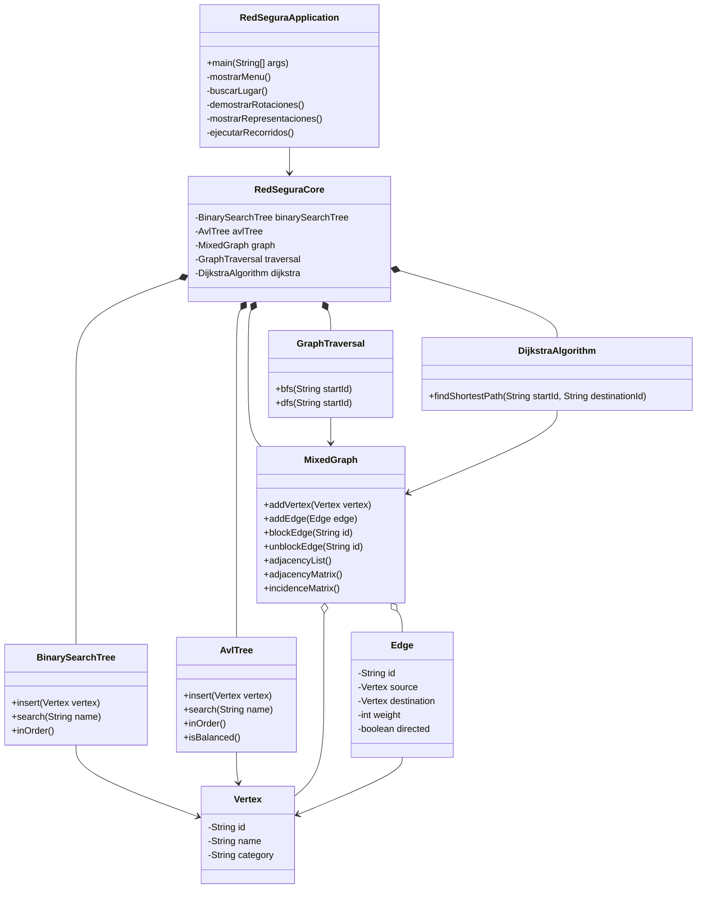

# Diagrama de clases y dependencias de RedSegura

## Explicación

- RedSeguraApplication: contiene el menú de consola.
- RedSeguraCore: integra las estructuras y algoritmos.
- Vertex: representa los lugares de la red.
- Edge: representa las conexiones entre lugares.
- BinarySearchTree: implementa el árbol binario de búsqueda.
- AvlTree: implementa el árbol autoequilibrado.
- MixedGraph: administra vértices, conexiones y representaciones.
- GraphTraversal: implementa BFS y DFS.
- DijkstraAlgorithm: calcula las rutas de menor costo.
